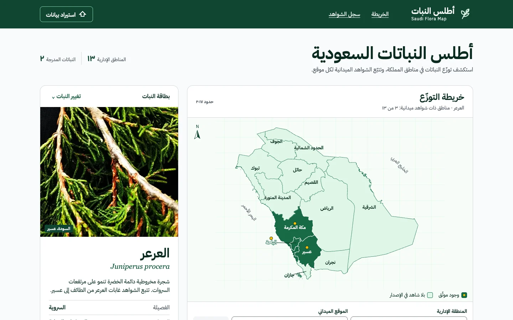

# Saudi Flora Map | أطلس النباتات السعودية

An independent Arabic RTL botanical atlas of Saudi Arabia. Select a species, tap a region or choose a locality, and open the field evidence behind the highlight. The prototype includes 13 administrative regions, two species and six verified locality records. Green regions have at least one documented occurrence in this release. Other regions have no record in the current sample.



## Run locally

Use Node.js 22.12 or newer and npm. The application and its assets live on `feature/saudi-flora-map`. The initial `main` branch is an empty baseline.

```sh
git clone --branch feature/saudi-flora-map https://github.com/haithamnaddaf/saudi-flora-map.git
cd saudi-flora-map
npm ci
npm run dev -- --port 4177 --strictPort
```

Open [the local atlas](http://127.0.0.1:4177/). To try it, choose عسير, narrow to تنومة and open the Scientific Reports reference. Use تغيير النبات to search for القرم or Avicennia marina. Use استيراد بيانات to download the Excel template and stage a draft. All runtime assets, including Arabic fonts, are served from the app origin.

## Architecture

| Layer | Responsibility |
| --- | --- |
| `public/data/regions.v1.json` | Projected, simplified ADM1 polygons with stable ISO 3166-2 codes. The pinned 2017 geoBoundaries source and ODbL terms are recorded in `BOUNDARIES.txt`. The geometry can be regenerated with `scripts/prepare-boundaries.py`. |
| `public/data/distribution.v1.0.0.json` | Versioned species cards, scientific names, locality records, evidence summaries, source URLs, locators and review status. |
| `src/catalog.js` | Shared dataset validation, filter queries, Excel row validation and exact external-ID resolution. |
| `src/map.js`, `src/app.js` | Native SVG and HTML interaction with equivalent region and place selectors, Arabic search and responsive callouts. Vite builds the static site into `dist/`. |
| `src/importer.js` | Loads the Excel reader on demand. File validation, preview and JSON export run in the browser. |
| `public/data/bindings.v1.json` | Independent crosswalk from opaque external ID pairs to local species IDs. |

### Embed contract v1

A host embeds the app URL in an iframe and passes percent-encoded, case-sensitive `entryId` and `senseId` query parameters. `embed=1` presents the map, card and evidence without the standalone header. A mapped pair locks the species in embed mode. A partial, repeated, or unknown pair opens an explicit unmapped state. With both identifiers omitted, the atlas opens in browsing mode.

```html
<iframe
  title="التوزع الجغرافي للنبات في السعودية"
  src="http://127.0.0.1:4177/?embed=1&amp;entryId=demo-juniper&amp;senseId=botanical"
  width="100%" height="800" loading="lazy" referrerpolicy="no-referrer">
</iframe>
```

The checked-in bindings are demonstration IDs. The integration owner adds real pairs to the crosswalk when available. Changing the iframe URL changes the context. This contract requires no shared cookies, parent-window scripting, API keys, Siwar source code or database connection. A future host needs its own approved frame policy and application origin.

## Data and Excel workflow

1. Download the workbook through the import dialog. In the **Records** sheet, keep the seven header names. Each row supplies `plantId`, `regionId`, `place`, `sourceTitle`, `sourceUrl`, `locator` and `evidence`. Use literal text and an HTTPS source. The Arabic guide sheet lists the recognized IDs.
2. Choose or drop one `.xlsx` of up to 2 MiB and 500 data rows. The preview reports row numbers for invalid fields, unknown IDs, missing evidence, unsafe URLs or duplicate evidence. A failed batch exports no records.
3. Download the valid versioned draft. Its existing release records are preserved and every added row has status `pending`. Imports are session-local. Reloading or closing the dialog clears the working preview. Save the downloaded JSON to retain it.
4. A curator follows the cited source and locator, checks the taxon, locality and administrative assignment, and marks accepted evidence `verified` in a new dataset version. Validate a candidate with `npm run validate -- path/to/candidate.json`. Keep the previous release, set the new filename, version and date, and update `RELEASE` in `src/catalog.js` when adopting it on the feature branch.

### Evidence scope

| Species | Localities in the prototype | Primary source |
| --- | --- | --- |
| العرعر · *Juniperus procera* | Al-Shafa, Al-Mandaq, Al-Soudah and Tanumah | [Al-Yasi, Scientific Reports (2025), Table 1](https://doi.org/10.1038/s41598-025-13677-x) |
| القرم · *Avicennia marina* | Farasan Archipelago | [Forests (2020), field sampling and Table 2](https://doi.org/10.3390/f11121287) |
| القرم · *Avicennia marina* | Thuwal | [Biogeosciences (2025), §2.1 and Figure 1](https://doi.org/10.5194/bg-22-117-2025) |

Dots flag regional evidence next to the region name. Their positions are cartographic label placements. Each record describes the locality supported by its source. Photo locations and attribution are provided separately in [image credits](public/images/CREDITS.txt). Derived map geometry carries the [boundary attribution and ODbL terms](public/data/BOUNDARIES.txt).

## Verify

```sh
npm test
npm run validate
npm run build
npm run check:uds
npx playwright install chromium
npm run test:browser
```

With Google Chrome already installed, use `BROWSER_CHANNEL=chrome npm run test:browser`. Browser tests build the production site, start a loopback server on port 4181, and verify touch, keyboard, search, import/export, errors, accessible rendering and cross-origin embedding. Python 3.9+ runs the UDS checker. See [design decisions](docs/design.md), [verification notes](docs/verification.md) and the [static checker report](docs/uds-report.json).
